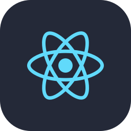
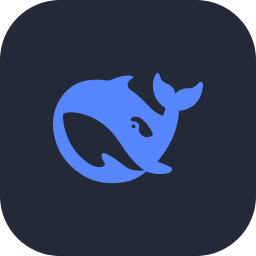
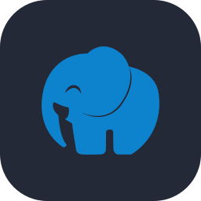
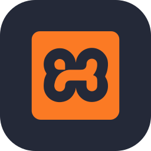

  <h1>Hey there 👋 I'm Essam, a Software Engineer</h1>
  

    
  

 

<!-->

  
  
  

 

## About Me

- 💼 **Software Engineer** building fast, beautiful apps for web & mobile
- 🛠️ **Tech I work with:** React, React Native, TypeScript, MySQL
- ⚡ **How I work:** AI-accelerated workflows to ship faster without cutting corners
- 🌱 **Currently exploring:** PHP, Laravel, WordPress, and AI integration in web & mobile apps
- 🔭 **Open to:** Full-time roles and freelance projects
- 🎯 **Goal:** Growing into a Full Stack Engineer across web & mobile
- 💬 **Ask me about:** Frontend, mobile apps, or anything tech — always happy to help!
- ❤️ **What I love:** Turning ideas into polished, real-world products

  ⭐ If you like my work, consider starring a repo — it means a lot!

 

## Tech Stack

### Frontend

  

### Mobile

  

### AI Tools

  
  
  
  
  

### Tools & Deployment

  
  
  

### Backend & Database

  
  

### Currently Learning

  

 

## GitHub Streak

  

