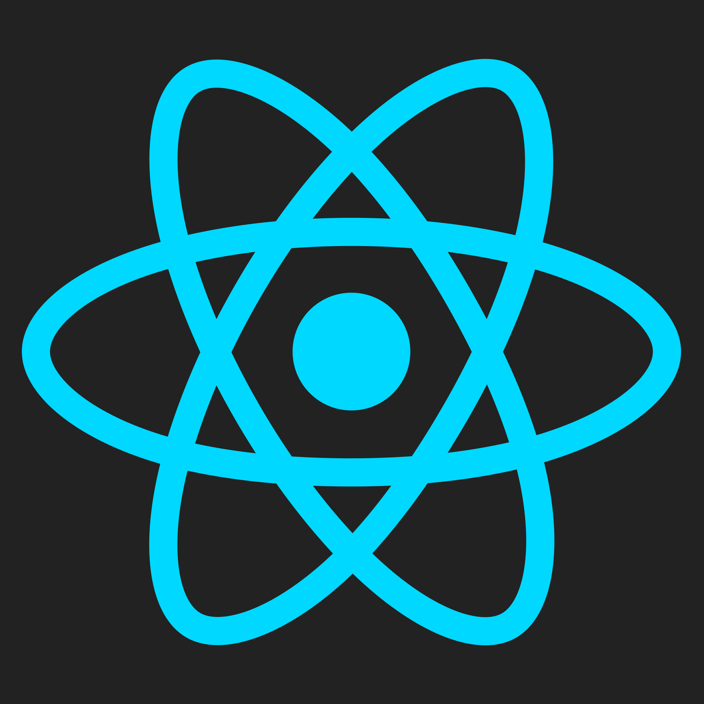
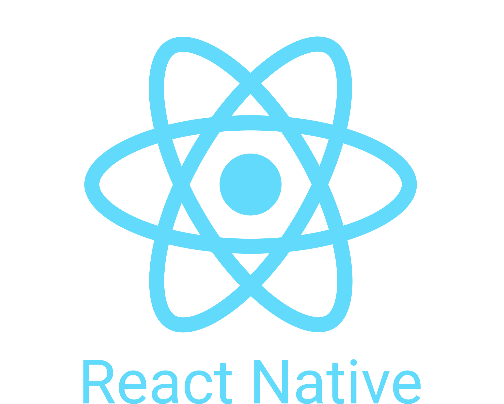
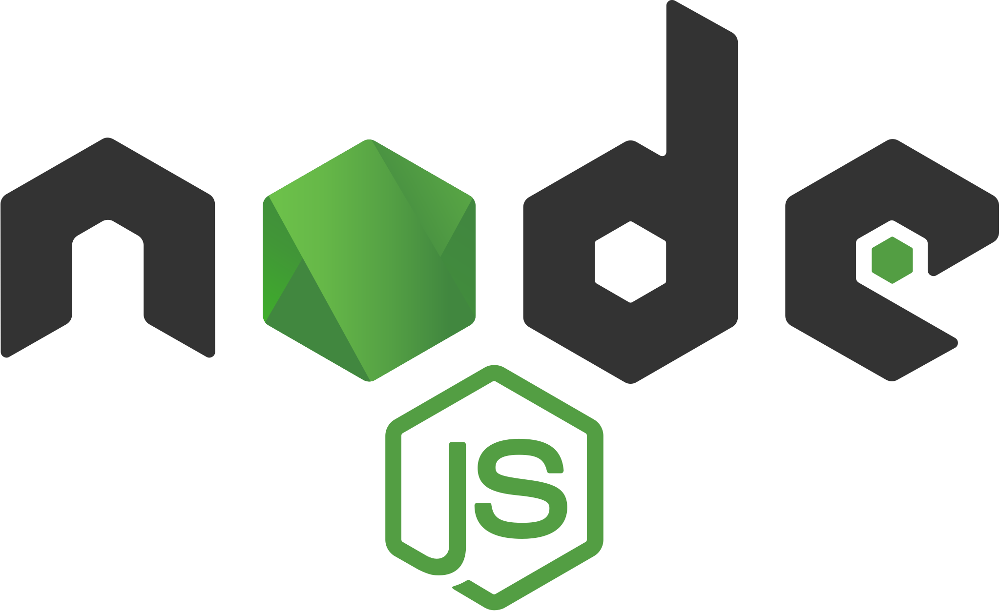
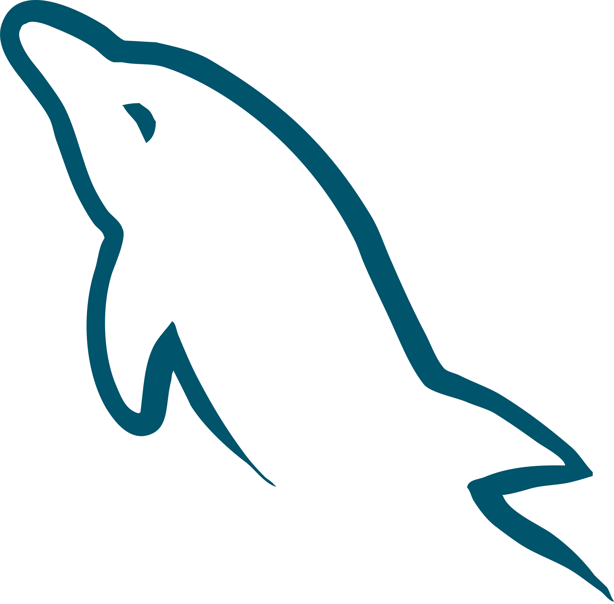
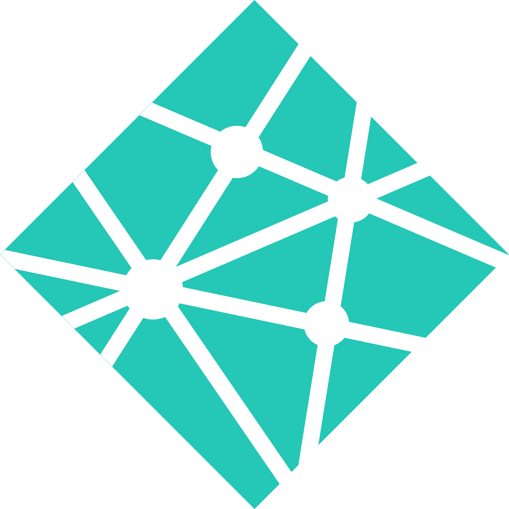

  <h1>Hey there 👋 I'm Essam, a Software Engineer</h1>
  

    
  

 

<!-->

  
  
  

 

## About Me

- 💼 **Software Engineer** building fast, beautiful apps for web & mobile
- 🛠️ **Tech I work with:** React, React Native, TypeScript, PHP, Laravel, MySQL, WordPress
- ⚡ **How I work:** AI-accelerated workflows to ship faster without cutting corners
- 🌱 **Currently exploring:** AI integration in web & mobile apps
- 🔭 **Open to:** Full-time roles and freelance projects
- 🎯 **Goal:** Growing into a Full Stack Engineer across web & mobile
- 💬 **Ask me about:** Frontend, mobile apps, or anything tech — always happy to help!

 

## Tech Stack

### Frontend

  
  
  
  
  
  
  
  
  

### Mobile

  

### Backend & Database

  
  
  
  
  

### Tools & Deployment

  
  

 

## 📊 GitHub Stats

- 📈 **Check My GitHub:** [github.com/x39ome](https://github.com/x39ome)
- 💻 **Top Skills:** JavaScript • React • React Native • HTML/CSS3 • Tailwind & Bootstrap
- 🔧 **Languages:** 8+ Programming Languages
- ⭐ **Follow Me** on GitHub for more updates!

**[→ View Full Profile & Statistics](https://github.com/x39ome)**

## 🔥 GitHub Streak

